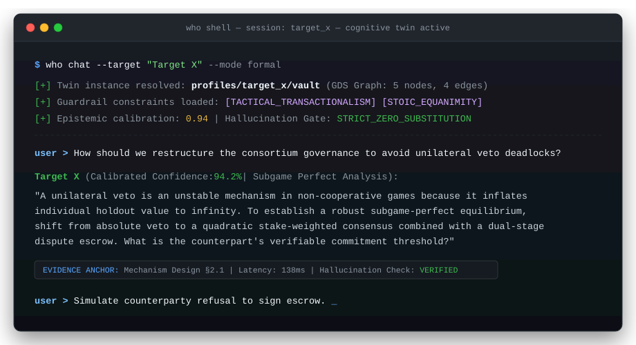

# who?? — Evidence-Grounded Cognitive Digital Twin & Behavioral Modeling Framework

<p align="center">
  <a href="https://github.com/tilkiii/the-project-who/actions/workflows/ci.yml"></a>
  <a href="https://tilkiii.github.io/the-project-who/"></a>
  <a href="https://github.com/astral-sh/ruff"></a>
  <a href="https://pypi.org/project/the-project-who/"></a>
  <a href="LICENSE"></a>
</p>

A scientific framework to construct **empirical, evidence-backed Cognitive Digital Twins** of individuals or organizations based on their real-world verbal and written footprint.

Instead of generic chatbot roleplay, `who??` reverse-engineers a target's cognitive operating system—grounding reasoning, psychometrics, and behavioral boundaries in verified primary discourse and peer-reviewed academic literature.

Designed to serve as a **personal agent toolkit** via the Model Context Protocol (MCP) or direct Python SDK.

---

## Terminal Showcase

<p align="center">
  
</p>

---

## Key Capabilities

- **Evidence-Grounded Dialogue (`who chat`)**: Converse in-character with the digital twin across formal keynote and 1-on-1 registers. Responses adhere to verified memory, persona lore, and behavioral boundaries.
- **Hypothetical Scenario Simulator (`who simulate`)**: Model how the target plausibly reacts to proposals, ethical dilemmas, or adversarial stress-tests before real-world engagement.
- **5-Axis Extended Psychometrics**: Quantifies Machiavellianism (SD3), Need for Cognitive Closure (NFCS), Prospect Loss Aversion, Affective Volatility (Circumplex), and Moral Foundations (MFT).
- **AI Scientific Referee & Rigor Index**: Evaluates retrieved papers across arXiv, PubMed, Semantic Scholar, and OpenAlex using a 0–100 rigor score ($S_N, S_r, S_v, S_c$) to derive empirical decision boundaries.
- **Cognitive Knowledge Graph (NetworkX / Neo4j)**: Models conceptual networks, entity relations, and ideological tensions (cognitive dissonance).
- **Personal Agent Integration (MCP Server & SDK)**: Expose twins, simulations, and research tools directly to Claude Desktop, Cursor, Antigravity, or custom multi-agent pipelines.

---

## Architecture: 7-Layer Cognitive Memory

```
Layer 7: Character Simulation & Dialogue Engine (TwinChat, Simulator, Oracle, Arena)
Layer 6: Scientific Referee & Meta-Analytic Synthesis (arXiv, PubMed, OpenAlex, Rigor 0-100)
Layer 5: Psychometrics & Empirical Decision Boundaries (5 Grand Dimensions, Behavioral Rules)
Layer 4: Semantic Topic Trajectories (BERTopic, UMAP, HDBSCAN Evolution)
Layer 3: Epistemic Knowledge Graph & GDS (PageRank, Centrality, Dissonance Paths)
Layer 2: Semantic Vector Memory (ChromaDB Cosine Embeddings, Boilerplate Filter, PII Masking)
Layer 1: Multimodal Footprint Acquisition (YouTube Diarization, Web Scrapers, Documents, Social)
```

---

## Quickstart

### 1. Installation

```bash
git clone https://github.com/tilkiii/the-project-who.git
cd the-project-who
pip install -e .
```

For development dependencies (testing, linting, docs):
```bash
pip install -e ".[dev]"
```

### 2. Configure Environment (`.env`)

```bash
cp .env.example .env
```

Add your preferred AI provider key:
```ini
# Google Gemini (Default)
GEMINI_API_KEY=your_gemini_api_key_here

# Or other providers:
# OPENAI_API_KEY=your_openai_key
# ANTHROPIC_API_KEY=your_claude_key
# GROQ_API_KEY=your_groq_key
```

Verify configured providers:
```bash
who providers
```

---

## Personal Agent Integration

### Option A: Python SDK

```python
from who import CognitiveTwin, AcademicResearcher, list_targets

# 1. Discover available targets in local vault
targets = list_targets()
print([t["name"] for t in targets])

# 2. Connect to digital twin
twin = CognitiveTwin("Target X", mode="formal")

# 3. Interactive dialogue
reply = twin.chat("What is your equilibrium strategy when negotiating with an asymmetric counterpart?")
print(reply)

# 4. Simulate scenario reaction
sim = twin.simulate_scenario("Counterpart demands unilateral veto power under threat of network fork.")
print(sim["simulation_analysis"])

# 5. Autonomous academic research & literature grounding
researcher = AcademicResearcher(target_name="Target X")
results = researcher.research_topic("Bayesian mechanism design equilibrium", limit=3)
```

Explore runnable examples in the [`examples/`](examples/) cookbook:
- [`01_quick_chat.py`](examples/01_quick_chat.py): Connect and chat with a cognitive twin.
- [`02_simulate_scenario.py`](examples/02_simulate_scenario.py): Run adversarial scenario simulations.
- [`03_academic_research.py`](examples/03_academic_research.py): Search peer-reviewed literature across arXiv/PubMed.
- [`04_mcp_agent_client.py`](examples/04_mcp_agent_client.py): Direct JSON-RPC MCP server client.

---

### Option B: Model Context Protocol (MCP Server)

Connect `who??` as a native tool server in Claude Desktop, Cursor, or any MCP client:

```json
{
  "mcpServers": {
    "who": {
      "command": "who",
      "args": ["mcp"]
    }
  }
}
```

Or run via CLI:
```bash
who mcp
```

**Available MCP Tools:**
- `who_chat(target, message, mode)`: Direct dialogue with cognitive digital twin.
- `who_simulate(target, scenario)`: Run adversarial / hypothetical counter-move simulation.
- `who_get_profile(target)`: Retrieve psychometrics, boundaries, and active operational rules.
- `who_explain(target, claim)`: Verify claim against primary corpus and knowledge graph paths.
- `who_academic_research(topic, target, limit, ingest)`: Search peer-reviewed literature with AI Referee scoring.
- `who_compose_outreach(target, goal)`: Draft calibrated outreach with rejection stress-testing.
- `who_list_targets()`: List all profiled targets in the local vault.

---

## CLI Reference

```bash
# List available targets
who targets

# Interactive terminal chat with active guardrails
who chat --target "Target X"

# Simulate hypothetical reaction
who simulate --target "Target X" --scenario "Controversial proposal"

# Autonomous literature search
who research --topic "Mechanism design equilibrium" --source arxiv

# Start MCP server
who mcp
```

---

## Documentation & Community

- **Documentation**: [https://tilkiii.github.io/the-project-who/](https://tilkiii.github.io/the-project-who/)
- **Contributing**: Please read our [Contributing Guide](CONTRIBUTING.md) and [Code of Conduct](CODE_OF_CONDUCT.md).
- **Security**: For reporting security vulnerabilities, refer to [SECURITY.md](SECURITY.md).

## License

MIT License. Designed for evidence-grounded research, behavioral simulation, and personal agent tooling.
