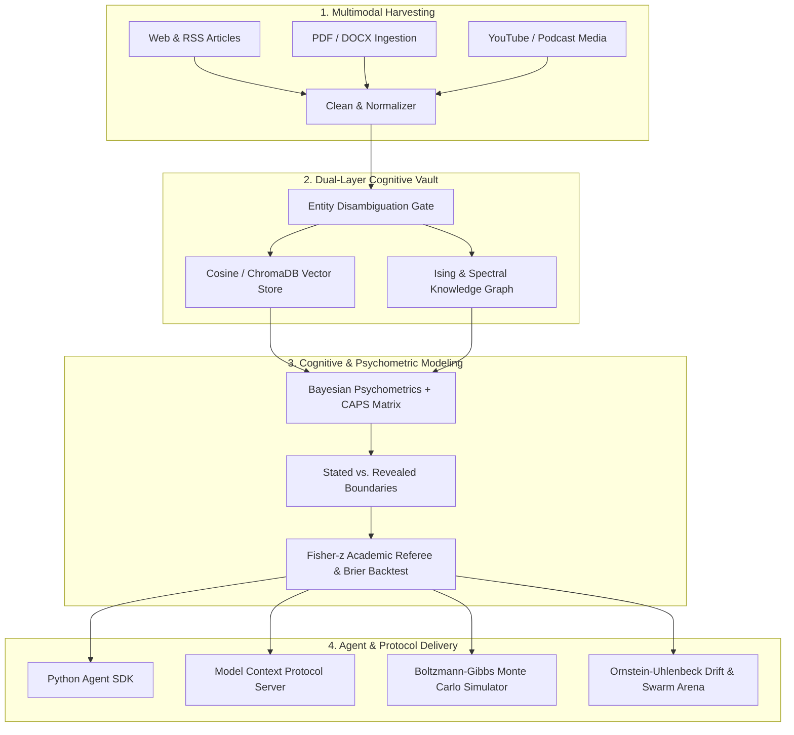

<div align="center">


# who??
### Evidence-Grounded Cognitive Digital Twin & Behavioral Modeling Toolkit for AI Agents

[](https://github.com/tilkiii/the-project-who/actions/workflows/ci.yml)
[](https://www.python.org/downloads/)
[](https://opensource.org/licenses/MIT)
[](https://modelcontextprotocol.io)
[](https://m8ven.ai/mcp/tilkiii/the-project-who?s=readme)
[](https://github.com/astral-sh/ruff)

<p align="center">
  <b>Transform fragmented OSINT footprints, speeches, transcripts, and academic publications into mathematically calibrated cognitive digital twins, probabilistic scenario simulators, and MCP agent tools.</b>
</p>

</div>

---

## Overview

**`who??`** is an open-source, evidence-grounded framework designed to reconstruct psychological profiles, empirical decision boundaries, and interactive digital twins from open-source intelligence (OSINT).

Unlike generic character chatbots that hallucinate personalities from loose vibes, `who??` separates **deterministic quantitative modeling** from LLM text synthesis: all psychometric indices, Bayesian 95% credible intervals, Boltzmann-Gibbs (QRE) decision distributions, Ising frustration energies, Jensen-Shannon Divergences (JSD), and out-of-sample **Brier Score** backtests are computed reproducibly in pure Python (`random_seed`-controlled), while LLMs are used only for grounded natural-language synthesis.

```
   Public Footprint             Knowledge & Graph                Cognitive Twin
 [Articles / Transcripts] ──► [Vector + Ising Concept Graph] ──► [Agent SDK / MCP / CLI]
 [Podcasts / PDFs / RSS]  ──► [Bayesian & CAPS Psychometrics] ──► [Boltzmann QRE Simulator]
```

> [!TIP]
> **⚡ Instant Claude Desktop & Cursor MCP Setup:**
> Add `who??` directly to your `claude_desktop_config.json`:
> ```json
> {
>   "mcpServers": {
>     "who": {
>       "command": "uvx",
>       "args": ["the-project-who", "mcp"]
>     }
>   }
> }
> ```
> *Run directly without manual environment cloning.*

---

## Scientific & Mathematical Foundations

| Capability | Methodology & Mathematical Engine | What It Solves |
|---|---|---|
| **Negation-Aware Bayesian Psychometrics** | Syntactic negation reversal + Beta-Binomial **95% Credible Intervals** across 5 dimensions (*Machiavellianism, Need for Closure, Loss Aversion β, Affective Volatility, Moral Foundations*) | Prevents false keyword hits (e.g., *"no risk"*) and scales uncertainty margins dynamically with corpus size |
| **Context-Conditional CAPS Matrix** | Walter Mischel's Cognitive-Affective Personality System (`IF [Situational Context] -> THEN [Behavioral Signature]`) across Academic, Crisis, Negotiation, and Dialogue domains | Models how a person's rigidity and risk tolerance shift across different situations instead of assuming static traits |
| **Stated vs. Revealed Preference** | Samuelson's econometric separation of normative public rhetoric (*Stated*) vs. documented historical decisions (*Revealed*) | Simulates both what a target will **publicly say** and what they will **operationally execute** |
| **Boltzmann-Gibbs (QRE) & Monte Carlo** | Quantal Response Equilibrium (`P(aᵢ) = exp(β·Uᵢ) / Z`) with inverse cognitive temperature `β = 1/T`, Shannon Decision Entropy `S`, and Helmholtz Free Energy `F` | Replaces deterministic choices with bounded-rationality probability distributions and phase-transition detection |
| **Complex Network & Ising Frustration** | Signed Ising Spin-Glass Hamiltonian (`H = -∑ Jᵢⱼ sᵢ sⱼ`), Structural Frustration (`Φ`), and Spectral Laplacian Algebraic Connectivity (`λ₂`) | Quantifies internal cognitive dissonance in a single target or across multiple debating twins (`SwarmArena`) |
| **Empirical Verification & Calibration** | Out-of-sample **Temporal Holdout Backtesting** (75% train / 25% test **Brier Score**), **Jensen-Shannon Divergence (JSD)** stylometric referee, and Inverse-Variance **Fisher Information** (`Iₖ = Nₖ - 3`) pooling | Replaces arbitrary LLM confidence numbers with empirically verified forecasting accuracy |

---

## Architectural Pipeline



---

## Quickstart

### 1. Installation

**Core Installation (Fast, zero C++ compiler requirements, Python 3.10–3.15+):**
```bash
pip install the-project-who
```

Or install from source:
```bash
git clone https://github.com/tilkiii/the-project-who.git
cd the-project-who
pip install -e .
```

**Optional Extras:**
```bash
# Persistent ChromaDB HNSW, Neo4j GDS driver, LiteLLM gateway, and scikit-learn:
pip install -e ".[full]"

# Development & testing tools (pytest, ruff, mypy):
pip install -e ".[dev]"
```

> **Note for Windows users:** If the `who` command is not on your PATH after installation, invoke the CLI directly with `python -m who.cli`.

### 2. Configure Environment (`.env`)

Copy `.env.example` to `.env` and add your preferred LLM API key (note: `who??` also includes a built-in **corpus-grounded offline fallback mode** so all mathematical engines, tests, and demos work even without an API key):
```bash
cp .env.example .env
```

```ini
# Primary Recommended LLM Provider (Google Gemini)
GEMINI_API_KEY=your_gemini_api_key_here

# Alternative Providers (optional)
OPENAI_API_KEY=your_openai_key_here
ANTHROPIC_API_KEY=your_anthropic_key_here
GROQ_API_KEY=your_groq_key_here
```

---

## Core Interfaces

### Option A: Python Agent SDK

Integrate `who??` directly into custom agent loops, LangChain, LlamaIndex, or AutoGen:

```python
from who import CognitiveTwin, AcademicResearcher, list_targets

# 1. Discover available targets in local vault
targets = list_targets()
print([t["name"] for t in targets])

# 2. Connect to digital twin
twin = CognitiveTwin("Target X", mode="formal")

# 3. Interactive dialogue (verified via Stylometric JSD Referee Gate)
reply = twin.chat("What is your equilibrium strategy when negotiating with an asymmetric counterpart?")
print(reply)

# 4. Boltzmann-Gibbs Monte Carlo Simulation (Stated vs. Revealed + CAPS Context)
sim = twin.simulate_monte_carlo(
    scenario="Hostile consortium demands transfer of cryptographic keys under 24h deadline.",
    iterations=25,
)
print(f"Dominant Branch: {sim['dominant_branch']} ({sim['branch_probabilities'][sim['dominant_branch']]*100:.1f}%)")
print(f"Boltzmann QRE Entropy (S): {sim['statistical_mechanics']['shannon_decision_entropy_S']}")
print(f"Stated vs. Revealed Divergence: {sim['dual_layer_prediction']['preference_divergence_index']}")

# 5. Out-of-Sample Temporal Holdout Backtest (Brier Score)
bt = twin.backtest(holdout_ratio=0.25)
print(f"Brier Score: {bt['brier_score']} | Calibrated Confidence: {bt['empirical_confidence_score']}")

# 6. Ornstein-Uhlenbeck Longitudinal Cognitive Drift Audit
drift = twin.analyze_drift()
print(f"Drift Verdict: {drift['verdict']} ({drift['stochastic_drift_physics']['dynamical_regime']})")
```

Explore runnable examples in the [`examples/`](examples/) cookbook:
- [`01_quick_chat.py`](examples/01_quick_chat.py): Connect and chat with a cognitive twin.
- [`02_simulate_scenario.py`](examples/02_simulate_scenario.py): Run single-pass adversarial scenario simulations.
- [`03_academic_research.py`](examples/03_academic_research.py): Search peer-reviewed literature across arXiv/PubMed.
- [`04_mcp_agent_client.py`](examples/04_mcp_agent_client.py): Direct JSON-RPC MCP server client.
- [`05_monte_carlo_negotiation.py`](examples/05_monte_carlo_negotiation.py): Multi-iteration Monte Carlo negotiation & game theory simulation.

---

### Option B: Model Context Protocol (MCP Server)

Connect `who??` as a native tool server in Claude Desktop, Cursor, or any MCP client:

```json
{
  "mcpServers": {
    "who": {
      "command": "who",
      "args": ["mcp"]
    }
  }
}
```

**Available MCP Tools (All annotated with explicit MCP safety hints):**
- `who_chat(target, message, tone)`: Direct dialogue with cognitive digital twin.
- `who_simulate(target, scenario, monte_carlo, iterations)`: Run adversarial simulation or Boltzmann-Gibbs Monte Carlo game theory analysis.
- `who_get_profile(target)`: Retrieve Bayesian psychometrics, CAPS matrix, stated vs. revealed preferences, and operational rules.
- `who_explain(target, claim)`: Verify claim against primary corpus and knowledge graph paths.
- `who_academic_research(topic, target, limit, ingest)`: Search peer-reviewed literature with Inverse-Variance Fisher Information scoring.
- `who_compose_outreach(target, goal, context)`: Draft communication aligned with the profiled subject's epistemic framing and evaluate potential conceptual friction points.
- `who_list_targets()`: List all profiled targets in the local vault.

---

## CLI Reference

```bash
# Verify system health, active providers, and MCP readiness
who doctor

# List available targets in vault
who targets

# Build & evaluate a target profile
who harvest --target "Target X" --urls "https://example.org/manifesto"
who learn --target "Target X"
who build-vault --target "Target X"
who evaluate-profile --target "Target X"
who graph --target "Target X"

# Interactive terminal chat with Stylometric JSD diagnostics
who chat --target "Target X"

# Multi-iteration Boltzmann-Gibbs Monte Carlo Simulation
who simulate --target "Target X" --scenario "Controversial acquisition proposal" --monte-carlo --iterations 25

# Multi-Agent Coupled Ising Debate Arena
who arena --targets "Target X, Test Target" --topic "Decentralized vs centralized governance" --rounds 2

# Ornstein-Uhlenbeck temporal cognitive drift analysis
who monitor --target "Target X" --drift
```

---

## Methodological Limitations & Ethical Scope

To maintain strict scientific transparency, users and researchers should account for the following boundaries:

1. **Non-Clinical Scope (Goldwater Rule Alignment):** `who??` models observable linguistic, rhetorical, and decision-theoretic patterns from text corpora. It does **not** perform clinical psychological diagnosis, mental health assessment, or deterministic mind-reading.
2. **Population Priors vs. Ecological Inference:** Effect sizes (`r`) retrieved from peer-reviewed literature serve strictly as **Bayesian population priors** (weighted via Inverse-Variance Fisher Information) to initialize baseline thresholds; they do not prove individual-level causality and are updated as subject-specific corpus evidence grows.
3. **Curated Corpus & Ghostwriter Bias:** Public speeches, interviews, and published articles reflect public personas rather than unguarded private states. The *Stated vs. Revealed Preference* module explicitly flags rhetoric–action divergence, yet all outputs remain bounded by corpus quality and selection bias.
4. **Ethical & Consented Use:** This toolkit is designed for academic research, computational social science, public-domain historical modeling, and consented self-twinning. It must not be used for unauthorized surveillance, covert manipulation, or profiling private individuals without consent (see [SECURITY.md](SECURITY.md) and [CODE_OF_CONDUCT.md](CODE_OF_CONDUCT.md)).

---

## Documentation & Community

- **Documentation**: Explore guides and architecture specifications in the [`docs/`](docs/) directory.
- **Contributing**: Please read our [Contributing Guide](CONTRIBUTING.md) and [Code of Conduct](CODE_OF_CONDUCT.md).
- **Security**: For reporting security vulnerabilities, refer to [SECURITY.md](SECURITY.md).

## License

MIT License. Designed for evidence-grounded research, behavioral simulation, and personal agent tooling.

## Thanks
We thank Sude Naz Akcabağ for her contributions.
