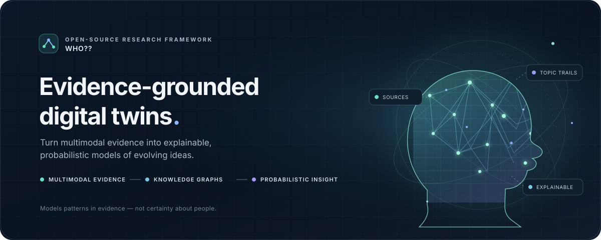
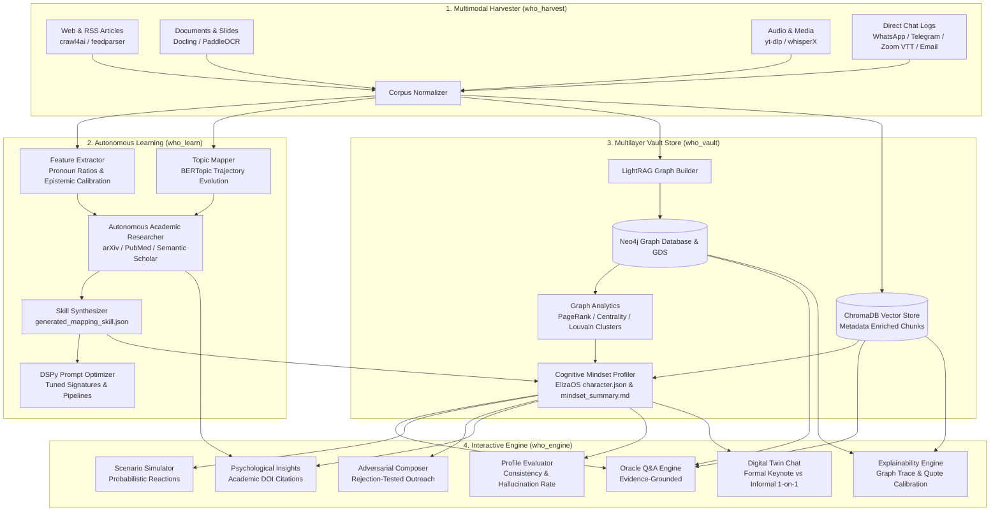

<div align="center">



<p align="center">
  <strong>Enterprise-Grade Multimodal OSINT Engine, Neo4j Graph Intelligence, BERTopic Evolution &amp; Evidence-Based Digital Twin Framework</strong>
</p>

<p align="center">
  <a href="pyproject.toml"></a>
  <a href="https://python.org"></a>
  <a href="tests/"></a>
  <a href="LICENSE"></a>
  <a href="https://neo4j.com"></a>
  <a href="https://trychroma.com"></a>
  <a href="https://maartengr.github.io/BERTopic/"></a>
  <a href="https://elizaos.github.io/eliza/"></a>
</p>

<p align="center">
  <a href="#quickstart">Quickstart</a> •
  <a href="#core-architecture">Architecture</a> •
  <a href="#7-layer-memory-architecture">7-Layer Memory</a> •
  <a href="#scientific-rigor--epistemology">Scientific Rigor</a> •
  <a href="#cli-command-reference">CLI Reference</a> •
  <a href="#ecosystem--acknowledgements">Acknowledgements</a> •
  <a href="#license">License</a>
</p>

---

</div>

## Overview

**`who??`** is a research-grade, target-agnostic open-source framework designed to construct evidence-backed cognitive digital twins and behavioral models of **ANY** target individual.

It adheres strictly to **scientific rigor, probabilistic reasoning, and explicit uncertainty quantification**. Deterministic claims regarding human motives, hidden psychology, or future actions are scientifically unfounded and strictly forbidden across all engine outputs.

### Key Capabilities
- **Multimodal Footprint Ingestion:** Deep parsing across web articles, RSS feeds, office documents (PDF, DOCX, PPTX via Docling), visual scans/infographics (PaddleOCR), audio streams (yt-dlp), and speaker-diarized transcripts (WhisperX tagging `[TARGET_PRIMARY]` vs `[INTERLOCUTOR_CONTEXT]`).
- **Knowledge Graph Intelligence:** Persistent Neo4j graph store with Graph Data Science (GDS) algorithms computing PageRank, degree/betweenness centrality, and Louvain community detection.
- **BERTopic Temporal Evolution:** Tracks target topic emergence, persistence, and abandonment trajectories over time.
- **Autonomous Literature Discovery:** Queries open scientific archives (arXiv, PubMed, Semantic Scholar) for peer-reviewed correlation models matching target linguistic features.
- **7-Layer Multilayer Memory:** Seamless memory spanning raw corpus text, ChromaDB vectors, Neo4j graphs, behavioral signals, topic trajectories, ElizaOS-compliant `character.json`, and stateful chat memory.
- **Adversarial Outreach & Simulation:** Scenario reaction simulation under explicit assumptions and hyper-tailored communication drafting with simulated adversarial rejection stress-testing.

---

## Core Architecture



---

## 7-Layer Memory Architecture

| Layer | Memory Layer Name | Technologies | Description |
| :---: | :--- | :--- | :--- |
| **1** | **Raw Corpus Memory** | Markdown, UTF-8 Normalizer | Raw diarized transcripts, scraped articles, Docling parsed trees, and dialogue context-response pairs. |
| **2** | **Semantic Embedding Memory** | ChromaDB, LiteLLM | Overlapping text chunks enriched with metadata tags (`source_type`, `visibility`, `speaker`). |
| **3** | **Knowledge Graph Memory** | Neo4j, Cypher, GDS, NetworkX | Persistent entity-concept graph featuring node versioning and primary quote evidence. |
| **4** | **Behavioral Signal Memory** | Statistical Lexical Parsers | Pronoun density ($I$ vs $we$ ratios), epistemic calibration ratio, and lexical diversity (TTR). |
| **5** | **Topic Evolution Memory** | BERTopic, TF-IDF Modeling | Temporal trajectory tracking classifying themes into emerging, persistent core, and abandoned topics. |
| **6** | **Cognitive Summary Memory** | ElizaOS Schema, Markdown | Synthesized `character.json`, `mindset_summary.md`, and evidence audit reports. |
| **7** | **Character Simulation Memory** | Dialogue State Tracking | Multi-turn contextual chat history supporting formal keynote vs informal 1-on-1 registers. |

---

## Scientific Rigor & Epistemology

`who??` enforces strict epistemological boundaries. Psychological and cognitive modeling can only be probabilistic, never deterministic.

### Terminology Mapping Rules

| Forbidden Deterministic Phrasing | Enforced Probabilistic Formulation |
| :--- | :--- |
| *Determine exactly how the target thinks* | **Infer likely reasoning patterns from observed evidence** |
| *Exact psychological mapping* | **Evidence-based behavioral modeling** |
| *Predict future behavior* | **Simulate plausible reactions under explicit assumptions** |
| *Target definitely will...* | **The target is plausibly inclined to...** |
| *Proves that the target believes...* | **The data suggests a plausible alignment with...** |

### Mandatory Output Phrasings
All conclusions generated by `who??` embed:
- `"Based on observed evidence from [Source X]..."`
- `"The data suggests a plausible alignment with [Pattern Y]..."`
- `"Confidence Score: X% (Derived from [N] supporting primary quotes)"`

---

## Quickstart

### 1. Installation
```bash
git clone https://github.com/tilkiii/who.git
cd who
pip install -r requirements.txt
pip install -e . --no-deps
```

### 2. Configuration (.env)
```bash
cp .env.example .env
```
`who??` features a multi-provider engine supporting any AI provider (Google Gemini, OpenAI, Claude, Groq, DeepSeek, OpenRouter, Ollama):
```ini
# Google Gemini (Default recommended)
GEMINI_API_KEY=your_gemini_key_here

# Or other providers:
# OPENAI_API_KEY=your_openai_key
# ANTHROPIC_API_KEY=your_claude_key
# GROQ_API_KEY=your_groq_key
# DEEPSEEK_API_KEY=your_deepseek_key
```

Verify your active AI provider setup at any time:
```bash
who providers
```
*(If no API keys are supplied, the framework automatically uses its resilient built-in local corpus synthesizer and deterministic epistemic modeling engine.)*

---

## CLI Command Reference

All CLI subcommands are available via `who` or `python main.py`:

```bash
# 1. Harvest target public footprint, articles, PDFs, videos, and chat logs
who harvest --target "Target Name" --urls "https://example.com/article,https://youtube.com/watch?v=..." --docs-dir "/path/to/docs" --chat-logs "/path/to/chat.vtt"

# 2. Learn behavioral markers, model topic trajectories, and synthesize scientific skills
who learn --target "Target Name"

# 3. Inspect topic evolution, emergence, persistence, and abandonment
who topics --target "Target Name"

# 4. Construct Knowledge Graph, execute Neo4j GDS, embed ChromaDB, and synthesize ElizaOS character
who build-vault --target "Target Name"

# 5. Inspect Neo4j GDS PageRank, centrality, and community clusters
who graph --target "Target Name"

# 6. Export the complete Knowledge Graph to JSON
who graph-export --target "Target Name" --output "graph_export.json"

# 7. Audit profile consistency, citation validity, and hallucination rate
who evaluate-profile --target "Target Name"

# 8. Trace any claim back to primary quotes, Neo4j graph paths, and confidence scores
who explain --target "Target Name" --claim "Target rejects centralized governance"

# 9. Generate behavioral reports citing quotes and academic literature DOIs
who psych-insights --target "Target Name"

# 10. Evidence-grounded Q&A backed by Graph + Vector memory
who ask --target "Target Name" --prompt "What is Target's view on decentralized consensus?"

# 11. Simulate plausible reactions and counter-moves under explicit assumptions
who simulate --target "Target Name" --scenario "A consortium asks Target to endorse a closed-source protocol"

# 12. Compose hyper-tailored outreach letters with adversarial rejection stress-testing
who compose --target "Target Name" --goal "Invite Target to keynote on open consensus"

# 13. Interactive digital twin chat with formal/informal tone toggling
who chat --target "Target Name" --mode formal

# 14. Audit and inspect active and configured AI providers
who providers
```

---

## Ecosystem & Acknowledgements

`who??` stands upon the shoulders of remarkable open-source projects. We gratefully acknowledge and credit the following repositories and research teams:

| Repository | Project Name | License | Role in `who??` |
| :--- | :--- | :--- | :--- |
| [`unclecode/crawl4ai`](https://github.com/unclecode/crawl4ai) | Crawl4AI | Apache 2.0 | High-performance LLM-ready web crawling and markdown extraction |
| [`DS4SD/docling`](https://github.com/DS4SD/docling) | Docling (IBM) | MIT | Deep structured document parsing for PDFs, DOCX, PPTX, and tables |
| [`PaddlePaddle/PaddleOCR`](https://github.com/PaddlePaddle/PaddleOCR) | PaddleOCR | Apache 2.0 | Ultra-lightweight structured OCR for slides, scans, and infographics |
| [`m-bain/whisperX`](https://github.com/m-bain/whisperX) | WhisperX | BSD-2-Clause | High-speed STT with PyAnnote word-level speaker diarization |
| [`yt-dlp/yt-dlp`](https://github.com/yt-dlp/yt-dlp) | yt-dlp | Unlicense | Universal media and audio extraction across YouTube, podcasts, and Vimeo |
| [`MaartenGr/BERTopic`](https://github.com/MaartenGr/BERTopic) | BERTopic | MIT | Dynamic topic modeling, temporal evolution, and trajectory tracking |
| [`stanfordnlp/dspy`](https://github.com/stanfordnlp/dspy) | DSPy (Stanford) | MIT | Programmatic prompt optimization, compilation, and evaluation |
| [`BerriAI/litellm`](https://github.com/BerriAI/litellm) | LiteLLM | MIT | Unified interface for OpenAI, Anthropic, Gemini, Groq, Ollama, and vLLM |
| [`neo4j/neo4j`](https://github.com/neo4j/neo4j) | Neo4j & GDS | GPL/Commercial | Persistent enterprise knowledge graph, PageRank, and community detection |
| [`chroma-core/chroma`](https://github.com/chroma-core/chroma) | ChromaDB | Apache 2.0 | AI-native open-source embedding database for semantic vector retrieval |
| [`elizaOS/eliza`](https://github.com/elizaOS/eliza) | ElizaOS | MIT | Standardized open-source character specification for autonomous agents |

---

## Automated Test Suite

The framework includes a comprehensive test suite across all 4 modules:
```bash
python -m pytest -v
```
```
============================= 28 passed in 41.76s =============================
```

---

## Author & Maintainer

- **Author:** [Mucteba Özdemir](https://github.com/tilkiii) (`@tilkiii`)
- **Repository:** [`https://github.com/tilkiii/who`](https://github.com/tilkiii/who)

---

## License

This project is licensed under the **MIT License** - see the [LICENSE](LICENSE) file for details.  
Copyright (c) 2026 Mucteba Özdemir (`tilkiii`).
