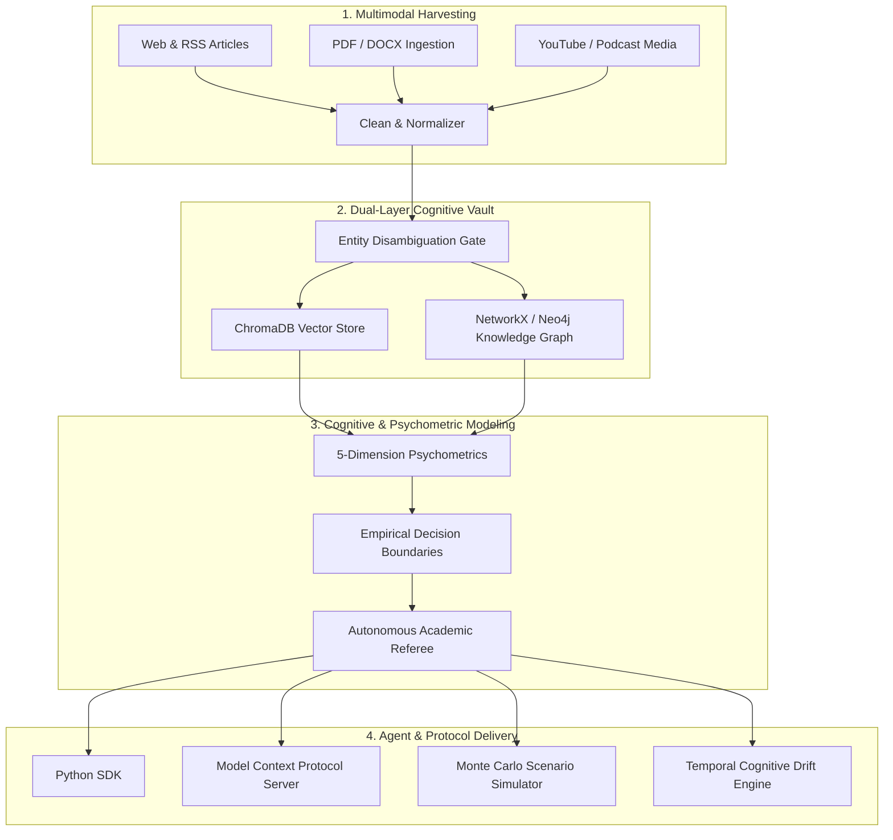

<div align="center">


# who??
### Evidence-Grounded Cognitive Digital Twin & Behavioral Modeling Toolkit for AI Agents

[](https://github.com/tilkiii/the-project-who/actions/workflows/ci.yml)
[](https://pypi.org/project/the-project-who/)
[](https://www.python.org/downloads/)
[](https://opensource.org/licenses/MIT)
[](https://github.com/astral-sh/ruff)
[](docs/)

<p align="center">
  <b>Transform fragmented OSINT footprints, speeches, transcripts, and academic publications into mathematically calibrated cognitive digital twins, probabilistic scenario simulators, and MCP agent tools.</b>
</p>

</div>

---

## Overview

**`who??`** is an open-source, evidence-grounded framework designed to reconstruct psychological profiles, empirical decision boundaries, and interactive digital twins from open-source intelligence (OSINT).

Unlike generic character chatbots that hallucinate personalities from loose vibes, `who??` operates under strict **epistemic grounding**: every behavioral rule, simulated negotiation counter-move, and psychometric metric is linked to primary corpus citations and peer-reviewed behavioral science papers (arXiv, PubMed, Semantic Scholar, OpenAlex).

```
   Public Footprint             Knowledge & Graph                Cognitive Twin
 [Articles / Transcripts] ──► [ChromaDB + NetworkX/Neo4j] ──► [Agent SDK / MCP / CLI]
 [Podcasts / PDFs / RSS]  ──► [5-Dimension Psychometrics] ──► [Monte Carlo Simulator]
```

---

## Architectural Pipeline



---

## Tech Stack

| Category | Technologies & Tools |
|---|---|
| **Core & Systems** | Python 3.10+, Pydantic v2, Typer, Rich |
| **Agent Protocols** | Model Context Protocol (MCP - JSON-RPC 2.0 stdio) |
| **Vector & Graph Storage** | ChromaDB (Cosine embeddings), NetworkX, Neo4j Graph Data Science |
| **LLM & Inference** | Google Gemini (Native API), OpenAI, Anthropic Claude, Groq, DSPy |
| **Academic Meta-Analysis** | arXiv API, PubMed (E-Utilities), Semantic Scholar, OpenAlex |
| **Quality & CI/CD** | Pytest, Ruff, Pre-commit, GitHub Actions Matrix CI |

---

## Quickstart

### 1. Installation

Install directly from PyPI:
```bash
pip install the-project-who
```

Or install from source:
```bash
git clone https://github.com/tilkiii/the-project-who.git
cd the-project-who
pip install -e .
```

> **Note for Windows users:** If the `who` command is not recognized in your shell after installation, ensure Python's `Scripts/` directory is in your system PATH, or invoke the CLI directly using `python -m who.cli`.

For development dependencies (testing, linting, packaging):
```bash
pip install -e ".[dev]"
```

### 2. Configure Environment (`.env`)

Copy the template and set your API keys:
```bash
cp .env.example .env
```

```ini
# Primary Recommended LLM Provider (Google Gemini)
GEMINI_API_KEY=your_gemini_api_key_here

# Alternative Providers (optional)
OPENAI_API_KEY=your_openai_key_here
ANTHROPIC_API_KEY=your_anthropic_key_here
GROQ_API_KEY=your_groq_key_here
```

---

## Core Interfaces

### Option A: Python Agent SDK

Integrate `who??` directly into custom agent loops, LangChain, LlamaIndex, or AutoGen:

```python
from who import CognitiveTwin, AcademicResearcher, list_targets

# 1. Discover available targets in local vault
targets = list_targets()
print([t["name"] for t in targets])

# 2. Connect to digital twin
twin = CognitiveTwin("Target X", mode="formal")

# 3. Interactive dialogue
reply = twin.chat("What is your equilibrium strategy when negotiating with an asymmetric counterpart?")
print(reply)

# 4. Monte Carlo Game-Theoretic Simulation (Game Theory 2.0)
sim = twin.simulate_monte_carlo(
    scenario="Hostile consortium demands transfer of cryptographic keys under 24h deadline.",
    iterations=25,
)
print(f"Dominant Branch: {sim['dominant_branch']} ({sim['branch_probabilities'][sim['dominant_branch']]*100}%)")
print(f"Expected Nash Payoff: {sim['expected_nash_payoff']}")
print(f"Critical Sensitivity Driver: {sim['critical_sensitivity']['key_variable']}")

# 5. Longitudinal Cognitive Drift Audit
drift = twin.analyze_drift()
print(f"Drift Classification: {drift['verdict']}")

# 6. Autonomous academic research & literature grounding
researcher = AcademicResearcher(target_name="Target X")
results = researcher.research_topic("Bayesian mechanism design equilibrium", limit=3)
```

Explore runnable examples in the [`examples/`](examples/) cookbook:
- [`01_quick_chat.py`](examples/01_quick_chat.py): Connect and chat with a cognitive twin.
- [`02_simulate_scenario.py`](examples/02_simulate_scenario.py): Run single-pass adversarial scenario simulations.
- [`03_academic_research.py`](examples/03_academic_research.py): Search peer-reviewed literature across arXiv/PubMed.
- [`04_mcp_agent_client.py`](examples/04_mcp_agent_client.py): Direct JSON-RPC MCP server client.
- [`05_monte_carlo_negotiation.py`](examples/05_monte_carlo_negotiation.py): Multi-iteration Monte Carlo negotiation & game theory simulation.

---

### Option B: Model Context Protocol (MCP Server)

Connect `who??` as a native tool server in Claude Desktop, Cursor, or any MCP client:

```json
{
  "mcpServers": {
    "who": {
      "command": "who",
      "args": ["mcp"]
    }
  }
}
```

Or run via CLI:
```bash
who mcp
```

**Available MCP Tools:**
- `who_chat(target, message, mode)`: Direct dialogue with cognitive digital twin.
- `who_simulate(target, scenario, monte_carlo, iterations)`: Run adversarial simulation or multi-iteration Monte Carlo game theory analysis.
- `who_get_profile(target)`: Retrieve psychometrics, boundaries, and active operational rules.
- `who_explain(target, claim)`: Verify claim against primary corpus and knowledge graph paths.
- `who_academic_research(topic, target, limit, ingest)`: Search peer-reviewed literature with AI Referee scoring.
- `who_compose_outreach(target, goal)`: Draft calibrated outreach with rejection stress-testing.
- `who_list_targets()`: List all profiled targets in the local vault.

---

## CLI Reference

```bash
# List available targets in vault
who targets

# Interactive terminal chat with active guardrails
who chat --target "Target X"

# Single-pass hypothetical scenario simulation
who simulate --target "Target X" --scenario "Controversial acquisition proposal"

# Multi-iteration Monte Carlo Game-Theoretic Simulation
who simulate --target "Target X" --scenario "Controversial acquisition proposal" --monte-carlo --iterations 25

# Autonomous live watcher & temporal cognitive drift analysis
who monitor --target "Target X" --drift

# Autonomous literature search
who research --topic "Mechanism design equilibrium" --source arxiv

# Start standard MCP stdio server
who mcp
```

---

## Documentation & Community

- **Documentation**: Explore guides and architecture specifications in the [`docs/`](docs/) directory.
- **Contributing**: Please read our [Contributing Guide](CONTRIBUTING.md) and [Code of Conduct](CODE_OF_CONDUCT.md).
- **Security**: For reporting security vulnerabilities, refer to [SECURITY.md](SECURITY.md).

## License

MIT License. Designed for evidence-grounded research, behavioral simulation, and personal agent tooling.
