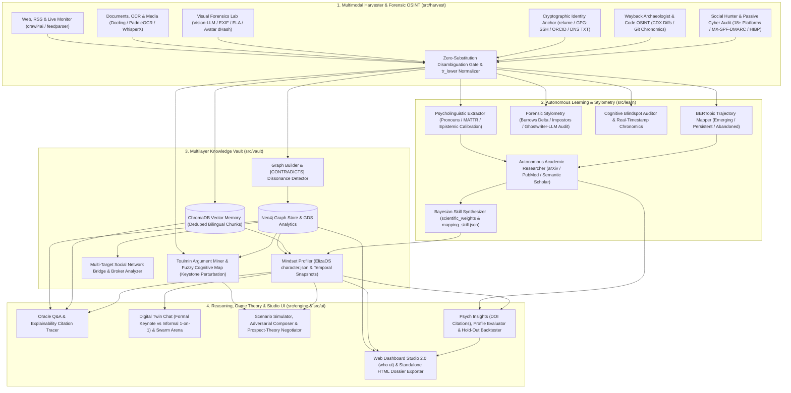

<div align="center">


<p align="center">
  <strong>Evidence-Based Cognitive Digital Twin, Forensic Stylometry &amp; Behavioral Modeling Framework<br/>Powered by Multimodal OSINT, Toulmin/FCM Reasoning, Neo4j Graph Intelligence &amp; ElizaOS Synthesis</strong>
</p>

<p align="center">
  <a href="https://pypi.org/project/the-project-who/"></a>
  <a href="https://pypi.org/project/the-project-who/"></a>
  <a href="https://python.org"></a>
  <a href="tests/"></a>
  <a href="#cli-command-reference"></a>
  <a href="#scientific-rigor--zero-substitution-protocol"></a>
  <a href="LICENSE"></a>
  <a href="https://d3js.org"></a>
  <a href="https://neo4j.com"></a>
  <a href="https://trychroma.com"></a>
  <a href="https://maartengr.github.io/BERTopic/"></a>
  <a href="https://elizaos.github.io/eliza/"></a>
</p>

<p align="center">
  <a href="#overview">Overview</a> •
  <a href="#core-capabilities">Capabilities</a> •
  <a href="#core-architecture">Architecture</a> •
  <a href="#7-layer-memory-architecture">7-Layer Memory</a> •
  <a href="#scientific-rigor--zero-substitution-protocol">Zero-Substitution &amp; Rigor</a> •
  <a href="#interactive-web-dashboard-20--html-dossiers">Web Studio 2.0</a> •
  <a href="#quickstart">Quickstart</a> •
  <a href="#cli-command-reference">CLI Reference</a> •
  <a href="#project-structure">Project Structure</a> •
  <a href="#automated-test-suite">Tests</a> •
  <a href="#license">License</a>
</p>

---

</div>

## Overview

**`who??`** is an open-source intelligence and behavioral research framework designed to construct **high-fidelity cognitive digital twins, forensic authorship profiles, and evidence-grounded decision models** of **ANY** individual from verifiable multimodal sources.

Instead of generic chatbot personas or hallucinated roleplay, `who??` builds an empirical replica grounded exclusively in a person's verified primary footprint—their syntactic rhythm, Toulmin argument warrants, core conceptual graph, cognitive blindspots, Git engineering DNA, archival discourse shifts, and published statements.

Every layer of the framework enforces **Strict Zero-Substitution Identity Verification**, **epistemic honesty**, **bilingual Turkish/English Unicode-safe NLP**, and **calibrated probabilistic reasoning** (evaluated via temporal hold-out Brier Scores and verbatim citation audits).

---

## Core Capabilities

### 1. Cognitive Digital Twins, Strategic Simulation & Game Theory
- **High-Fidelity Cognitive Digital Twins (`who chat`, `who ask`):** Synthesizes ElizaOS-standard `character.json` and `mindset_summary.md` backed by hybrid Neo4j + ChromaDB retrieval, with dynamic tone switching between *formal keynote* speeches and *informal 1-on-1* dialogue registers.
- **Game-Theoretic Multi-Turn Negotiation Simulator (`who negotiate`):** Combines **Prospect Theory** loss-aversion ($\lambda$) and concession elasticity ($\eta$) derived from psycholinguistic signals with Knowledge Graph `[REJECTS]` / `[CONTRADICTS]` *Red-Line Constraints* to simulate 3-stage Extensive-Form Negotiation Game Trees, BATNA walk-away thresholds, and optimal Pareto-improving packages.
- **Plausible Reaction & Adversarial Outreach Simulation (`who simulate`, `who compose`):** Models probable responses and counter-moves to hypothetical dilemmas under explicit scenario assumptions, and stress-tests outreach proposals against adversarial rejection filters.
- **Multi-Agent Dialectical Swarm Arena (`who arena`):** Pits two distinct cognitive digital twins against each other in structured multi-turn debates to quantify ideological convergence vs. irreconcilable conceptual friction.
- **Temporal Hold-Out Backtesting & Brier Calibration Lab (`who backtest`, `who evaluate-profile`):** Splits a target's chronological corpus into $T_{\text{train}}$ and unseen future $T_{\text{test}}$ windows with zero future data leakage, scoring predictive fidelity via **Stance Alignment Accuracy**, **Character 3-Gram Semantic Fidelity**, and probabilistic **Brier Score** calibration.

### 2. Forensic Stylometry, Toulmin Argumentation & Cognitive Auditing
- **Forensic Stylometry & Authorship Attribution (`who stylometry`):** Computes **Burrows' Delta** ($z$-score Manhattan distance across function-word & punctuation cadence), **Monte-Carlo Feature-Subsampling Verification** (Koppel's Impostors principle with finite-sample Poisson noise floors), **Moving-Average Type-Token Ratio (MATTR)**, and sentence burstiness to verify disputed documents and isolate ghostwritten or synthetic LLM-generated corpus outliers.
- **Toulmin Argumentation Mining & Fuzzy Cognitive Maps (`who arguments`):** Deconstructs raw discourse into structured **Toulmin Argument Schemas** (`Claim` → `Grounds` → `Warrant` → `Qualifier` → `Rebuttal`) and runs hyperbolic-tangent (`tanh`) **Fuzzy Cognitive Map (FCM)** counterfactual perturbations to identify *Keystone Assumptions* whose falsification triggers the largest downstream belief cascade.
- **Cognitive Blindspot, Fallacy & Safeguard Auditor (`who blindspots`):** Audits target-authored statements—strictly anchored to verbatim primary quotes—across 6 cognitive/rhetorical patterns (*False Dilemma*, *Absolutist Overgeneralization*, *Sunk-Cost Anchoring*, *Appeal to Authority*, *Causal Reductionism*, *Status-Quo Bias*), balanced against *Epistemic Safeguards* (*Steelmanning*, *Explicit Falsifiability*, *Intellectual Humility*).
- **Autonomous Academic Literature & Bayesian Skill Synthesis (`who learn`, `who psych-insights`):** Searches arXiv, PubMed, Semantic Scholar, and Crossref for peer-reviewed behavioral studies matching observed linguistic markers; extracts correlation coefficients ($r$), sample sizes ($N$), and $p$-values to Bayesian-calibrate `scientific_weights.json` and `generated_mapping_skill.json`.
- **Cognitive Chronomics & Epistemic Manipulation Index (`who learn`, `who topics`):** Tracks BERTopic thematic emergence/abandonment, real timestamped circadian activity patterns (with strict zero-fabrication guards when night data is absent), and rhetorical certainty-inflation (*Epistemic Manipulation Index*).

### 3. Multimodal OSINT, Cryptographic Identity & Digital Archaeology
- **Cryptographic & Bidirectional Identity Anchoring (`who anchor`):** Constructs a deterministic Zero-Substitution Proof Graph using bidirectional HTML `<link rel="me">` handshakes, GitHub GPG (`openpgp`) & SSH SHA-256 key fingerprints, ORCID peer-reviewed scholarly records, and domain DNS `TXT` ownership proofs.
- **Wayback Machine Digital Archaeology (`who archaeology`) & Vault Drift (`who snapshot`, `who diff`):** Queries Internet Archive CDX multi-year snapshots to uncover *silent biographical deletions*, scrubbed affiliations, and longitudinal stance softening/hardening, paired with local vault snapshots to track cognitive drift across checkpoints.
- **Technical Twin Code & Commit Intelligence (`who code-osint`):** Extracts engineering DNA from public Git repositories—language/architecture stack evolution, commit message technical rigor, UTC timezone offset distributions, and nocturnal coding chronomics.
- **Multimodal Visual OSINT & Image Forensics (`who vision`):** Integrates Vision-LLM slide/whiteboard/scene analysis with **EXIF/GPS metadata extraction**, **Error Level Analysis (ELA)** recompression tamper detection, and cross-platform **64-bit Difference Hash (`dHash`)** avatar matching.
- **Zero-Hallucination Passive Cyber & Social Reconnaissance (`who hunt`, `who cyber`, `who monitor`, `who harvest`):** Performs 18+ platform handle enumeration, passive DNS-over-HTTPS `MX`/`SPF`/`DMARC` posture auditing, optional official HaveIBeenPwned v3 (`HIBP_API_KEY`) verified breach checks (zero fabricated breach records), live RSS anomaly monitoring, and multimodal ingestion (`crawl4ai`, `Docling`, `PaddleOCR`, `WhisperX` speaker diarization).

### 4. Bilingual Turkish/English NLP & Graph Intelligence
- **Turkish & English Unicode-Safe NLP Normalization:** Engineered with `tr_lower()` (eliminating Python's `"İ".lower() -> "i\u0307"` word-splitting & false English `"I"` pronoun artifacts while accurately mapping `"İ" -> "i"` and Turkish `"I" -> "ı"`), bilingual stopword filtering, Turkish-transliterating `sanitize_slug()`, TCKN/phone/email PII redaction, and speaker-turn isolation (`extract_target_primary_text()`) so interviewer prompts never pollute target metrics.
- **Neo4j GDS, `[CONTRADICTS]` Dissonance & Multi-Target Social Networks (`who graph`, `who network`):** Computes PageRank, Betweenness Centrality, Louvain communities, internal `[CONTRADICTS]` cognitive dissonance tension clusters, and cross-target bridge/broker force-directed graphs.

---

## Core Architecture



---

## 7-Layer Memory Architecture

| Layer | Memory Layer Name | Core Engines & Technologies | Description |
| :---: | :--- | :--- | :--- |
| **1** | **Raw & Forensic Corpus Memory** | UTF-8 + `tr_lower` Normalizer, `entity_validator`, `WaybackArchaeologist` | Speaker-isolated transcripts, scraped articles, Docling trees, OCR slides, archival diffs, code intelligence, and cryptographic identity proofs. |
| **2** | **Semantic Embedding Memory** | ChromaDB, Multi-Provider Embeddings | Content-hash deduplicated text chunks enriched with metadata (`source_type`, `visibility`, `speaker`) under Turkish-safe collection slugs. |
| **3** | **Knowledge & Dissonance Graph Memory** | Neo4j, Cypher, GDS, NetworkX | Persistent entity-concept graph featuring PageRank, Louvain clusters, `[CONTRADICTS]` cognitive dissonance edges, and cross-target bridge graphs. |
| **4** | **Psycholinguistic & Stylometric Memory** | `FeatureExtractor`, `ForensicStylometryEngine`, `CognitiveBiasAuditor`, `CognitiveChronomics` | Pronoun density, epistemic calibration, length-invariant MATTR, Burrows' Delta stylometric DNA, rhetorical manipulation index, verbatim blindspots, and circadian chronomics. |
| **5** | **Topic & Causal Argumentation Memory** | BERTopic, TF-IDF, `ToulminArgumentMiner`, `SnapshotManager` | Temporal topic emergence/abandonment, Toulmin `Claim-Grounds-Warrant-Rebuttal` schemas, Fuzzy Cognitive Map (`tanh`) keystone weights, and vault drift checkpoints. |
| **6** | **Cognitive Summary & Skill Memory** | ElizaOS Schema, Bayesian `SkillSynthesizer` | Synthesized `character.json`, `mindset_summary.md`, peer-reviewed `scientific_weights.json`, and `generated_mapping_skill.json`. |
| **7** | **Strategic Simulation & Calibration Memory** | `TwinChat`, `SwarmArena`, `GameTheoreticNegotiator`, `TemporalBacktester` | Register-aware dialogue state, dialectical twin debates, Prospect Theory extensive-form negotiation trees, and chronological Brier Score backtesting. |

---

## Scientific Rigor & Zero-Substitution Protocol

`who??` enforces strict operational and epistemological guardrails across data ingestion, identity resolution, and behavioral inference.

### 1. Strict Zero-Substitution Protocol & Disambiguation Gate (`src/utils/entity_validator.py`)
- **User Input Is Immutable Ground Truth:** Provided names, surnames, `@handles`, and email identifiers are never assumed to contain typos and are never auto-substituted.
- **Zero Name Expansion / Conflation:** Web results containing prefixed, suffixed, or expanded middle-name variants (for example, encountering *"Muhammet Mücteba Özdemir"* when the specified target is *"Mucteba Özdemir"*) are **strictly blocked** by the Disambiguation Gate—zero third-party data is merged into the target's corpus, graph, or vector vault.
- **Verified Primary Linkage Only:** Digital assets enter the intelligence dossier exclusively when anchored to the exact user-supplied identifier or cryptographically verified via bidirectional proofs (`who anchor`).

### 2. Zero-Hallucination Forensics & Probabilistic Epistemology
- **Zero Fabricated Cyber or Circadian Data:** `CyberFootprintAuditor` executes real passive DNS-over-HTTPS (`MX`, `SPF`, `DMARC`) checks and queries HaveIBeenPwned v3 *only* when an official `HIBP_API_KEY` is configured (explicitly reporting `UNVERIFIED_NO_BREACH_API_KEY` otherwise—never inventing placeholder breach records). Similarly, `CognitiveChronomics` refuses to extrapolate nocturnal fatigue multipliers when timestamped night observations are absent.
- **Calibrated Probabilistic Formulations:** Psychological and cognitive modeling is strictly probabilistic, never deterministic.

| Forbidden Deterministic Phrasing | Enforced Probabilistic Formulation |
| :--- | :--- |
| *Determine exactly how the target thinks* | **Infer likely reasoning patterns from observed primary evidence** |
| *Exact psychological mapping* | **Evidence-based behavioral & stylometric modeling** |
| *Predict future behavior* | **Simulate plausible reactions under explicit scenario assumptions** |
| *Target definitely will...* | **The target is plausibly inclined to...** |
| *Proves that the target believes...* | **The data suggests a plausible alignment with...** |

All analytical conclusions embed traceable provenance:
- `"Based on observed evidence from [Source X]..."`
- `"The data suggests a plausible alignment with [Pattern Y]..."`
- `"Confidence Score: X% (Derived from [N] supporting primary quotes)"`

---

## Interactive Web Dashboard 2.0 & HTML Dossiers

Launch the zero-dependency multi-threaded Web Studio locally:

```bash
who ui --port 8765
```

- **Interactive D3.js Knowledge & `[CONTRADICTS]` Dissonance Graph:** Explore core concepts, PageRank hubs, Louvain clusters, and red cognitive-dissonance tension edges visually.
- **Digital Twin Chat & Oracle Q&A Console:** Converse with any local profile in *Formal Keynote* or *Informal 1-on-1* mode or run evidence-grounded Oracle queries.
- **Scenario Simulator, Adversarial Outreach Composer & Multi-Agent Swarm Arena:** Run hypothetical stress tests, craft rejection-tested outreach, and watch two digital twins debate live in the browser.
- **Standalone Offline HTML Dossiers (`who export-dossier`):** Package a target's D3.js concept network, behavioral metrics, chronomics, and visual forensics into a single self-contained `.html` intelligence briefing file.

---

## Quickstart

### 1. Installation

#### Via Docker Compose (Full Stack: Web Studio + Neo4j GDS):
```bash
docker compose up -d
# Launches who?? Web Dashboard on http://localhost:8765 + Neo4j GDS Database
```

#### Via PyPI:
```bash
pip install the-project-who
```

#### From Source (Development):
```bash
git clone https://github.com/alpztel/the-project-who.git
cd the-project-who
pip install -r requirements.txt
pip install -e . --no-deps
```

### 2. Configuration (`.env`)
```bash
cp .env.example .env
```
`who??` includes a unified multi-provider AI router supporting **9 cloud & local LLM providers** out of the box (auto-detected in priority order, or pinned via `WHO_PROVIDER`):

```ini
# Primary Cloud Providers (set whichever key you prefer)
GEMINI_API_KEY=your_gemini_key_here
# OPENAI_API_KEY=your_openai_key
# ANTHROPIC_API_KEY=your_claude_key
# GROQ_API_KEY=your_groq_key
# DEEPSEEK_API_KEY=your_deepseek_key
# OPENROUTER_API_KEY=your_openrouter_key
# MISTRAL_API_KEY=your_mistral_key

# Fully Local / Self-Hosted Engines (No API key required)
# OLLAMA_API_BASE=http://localhost:11434
# VLLM_API_BASE=http://localhost:8000/v1

# Optional: Official HaveIBeenPwned v3 API Key for verified breach checks in `who cyber`
# HIBP_API_KEY=your_hibp_v3_key
```

Inspect active and available AI engines at any time:
```bash
who providers
```
*(If no external API keys are configured, `who??` seamlessly falls back to its built-in corpus-grounded `OfflineProvider` and deterministic statistical/epistemic engines—zero hardcoded filler lore.)*

---

## CLI Command Reference

All **34 CLI subcommands** are available via `who` (or `python main.py`), organized across 5 operational domains:

### 1. Multimodal Harvesting, Cryptographic Identity & Forensic OSINT (8 Commands)
```bash
# Harvest web articles, PDFs/slides (Docling/OCR), media (WhisperX diarization), and chat logs
who harvest --target "Target Name" --urls "https://example.com/post,https://youtube.com/watch?v=..." --docs-dir "/path/to/docs" --chat-logs "/path/to/chat.vtt"

# Cryptographic & bidirectional rel="me" identity anchoring (GPG/SSH fingerprints, ORCID, DNS TXT)
who anchor --target "Target Name" --website "https://target.site" --github "handle" --orcid "0000-0002-1825-0097"

# Enumerate verified username presence across 18+ platforms under Strict Zero-Substitution
who hunt --target "Target Name" --username "handle"

# Passive email DNS/MX/SPF/DMARC security posture, burner check & verified HIBP breach audit
who cyber --target "Target Name" --email "target@domain.com"

# Wayback Machine CDX digital archaeology (detect silent deletions & multi-year stance revisions)
who archaeology --target "Target Name" --url "https://target.site/about" --snapshots 4

# Technical Twin code & commit intelligence (language trajectory & Git timezone chronomics)
who code-osint --target "Target Name" --github "handle"

# Multimodal Visual OSINT: Vision-LLM slide/scene parsing, EXIF/GPS, ELA tamper score & Avatar dHash
who vision --target "Target Name" --images "/path/to/slides" --compare-avatars "avatar_gh.png,avatar_x.jpg"

# Monitor live RSS/web feeds for anomalous updates or breaking discourse shifts
who monitor --target "Target Name" --sources "https://example.com/rss"
```

### 2. Autonomous Learning, Forensic Stylometry & Cognitive Auditing (4 Commands)
```bash
# Extract bilingual psycholinguistic markers (MATTR, pronouns, chronomics) & synthesize academic skills
who learn --target "Target Name"

# Inspect BERTopic temporal evolution (emerging, persistent core, and abandoned themes)
who topics --target "Target Name"

# Forensic stylometry & authorship verification (Burrows' Delta, Impostors & ghostwriter/LLM outlier audit)
who stylometry --target "Target Name" --questioned-file "/path/to/disputed_text.txt"

# Verbatim-quote-backed cognitive blindspot, rhetorical heuristic & epistemic safeguard audit
who blindspots --target "Target Name"
```

### 3. Multilayer Vault, Toulmin Argumentation & Temporal Drift (6 Commands)
```bash
# Build Knowledge Graph, run Neo4j GDS, embed ChromaDB chunks & synthesize ElizaOS character.json
who build-vault --target "Target Name"

# Mine Toulmin argument schemas (Claim-Grounds-Warrant-Rebuttal) & Fuzzy Cognitive Map keystone beliefs
who arguments --target "Target Name"

# Inspect Neo4j GDS PageRank, Betweenness Centrality, Louvain clusters & [CONTRADICTS] dissonance
who graph --target "Target Name"

# Export the complete Knowledge Graph to structured JSON
who graph-export --target "Target Name" --output "graph_export.json"

# Capture timestamped cognitive vault snapshots for longitudinal comparison
who snapshot --target "Target Name" --label "q3_baseline"

# Quantify epistemic calibration, manipulation index, TTR & concept drift across snapshots
who diff --target "Target Name"
```

### 4. Digital Twin Reasoning, Negotiation, Arena & Backtesting (11 Commands)
```bash
# Interactive digital twin conversation with formal keynote vs informal 1-on-1 register toggling
who chat --target "Target Name" --mode formal

# Evidence-grounded Oracle Q&A backed by hybrid Neo4j Graph + ChromaDB Vector retrieval
who ask --target "Target Name" --prompt "What is Target's core warrant regarding open protocols?"

# Simulate plausible reactions and counter-moves to hypothetical scenarios
who simulate --target "Target Name" --scenario "A consortium asks Target to endorse a closed-source standard"

# Game-theoretic multi-turn negotiation simulator (Prospect Theory lambda/eta & Red-Line constraints)
who negotiate --target "Target Name" --objective "Joint open-protocol research alliance" --leverage "Open benchmark dataset"

# Compose hyper-tailored outreach stress-tested against adversarial rejection filters
who compose --target "Target Name" --goal "Invite Target to keynote on decentralized governance"

# Run a multi-agent dialectical Swarm Arena debate between two distinct digital twins
who arena --targets "Target A, Target B" --topic "Mandatory Frontier AI Licensing" --rounds 3

# Trace any analytical claim back to verbatim corpus quotes, graph paths & confidence scores
who explain --target "Target Name" --claim "Target prioritizes verifiable open infrastructure"

# Generate behavioral synthesis reports citing primary quotes and peer-reviewed academic DOIs
who psych-insights --target "Target Name"

# Audit citation validity, cross-layer profile consistency & empirical hallucination rate
who evaluate-profile --target "Target Name"

# Chronological hold-out backtesting (Stance Alignment, 3-Gram Fidelity & Brier Score calibration)
who backtest --target "Target Name" --train-ratio 0.70

# Export standalone interactive HTML intelligence dossier (D3 graph, chronomics, visual forensics)
who export-dossier --target "Target Name" --output "target_dossier.html"
```

### 5. Multi-Target Network, Web Studio & System Administration (5 Commands)
```bash
# Consolidate multi-target social knowledge graphs & export interactive D3.js force-directed HTML
who network --targets "Target A, Target B" --export-html

# Launch the interactive Web Dashboard Studio 2.0
who ui --port 8765

# Audit configured and active cloud/local AI providers
who providers

# List all local digital twin profiles, corpus asset counts & vault readiness statuses
who targets

# Safely purge a target profile and all associated local corpus/vault artifacts
who purge --target "Target Name"
```

---

## Project Structure

```text
the-project-who/
├── src/
│   ├── cli/                        # Modular Typer CLI (34 subcommands across 5 command modules)
│   │   └── commands/               # harvest.py, vault.py, twin.py, network.py, system.py
│   ├── harvest/                    # Layer 1: Multimodal Ingestion & Forensic OSINT
│   │   ├── web_harvester.py        # Web & RSS crawling (crawl4ai / feedparser)
│   │   ├── academic_harvester.py   # Scholarly metadata & publication ingestion
│   │   ├── document_ingestor.py    # Deep PDF/DOCX/PPTX structure parsing (Docling)
│   │   ├── ocr_processor.py        # Slide & infographic OCR (PaddleOCR)
│   │   ├── media_harvester.py      # YouTube/podcast stream extraction (yt-dlp)
│   │   ├── diarized_transcriber.py # Speaker-diarized STT (WhisperX)
│   │   ├── dialogue_harvester.py   # WhatsApp, Telegram, Zoom VTT & email thread parser
│   │   ├── visual_harvester.py     # Vision-LLM scenes, EXIF/GPS, ELA tamper & Avatar dHash
│   │   ├── identity_anchor.py      # Cryptographic GPG/SSH, rel="me", ORCID & DNS TXT proofs
│   │   ├── wayback_archaeologist.py# Internet Archive CDX multi-year biographical diffing
│   │   ├── code_intelligence.py    # GitHub stack evolution & commit timezone chronomics
│   │   ├── social_osint.py         # 18+ platform handle hunter (Zero-Substitution enforced)
│   │   ├── cyber_footprint.py      # Passive DNS MX/SPF/DMARC & verified HIBP v3 auditor
│   │   └── live_monitor.py         # Continuous feed & discourse anomaly monitor
│   ├── learn/                      # Layer 2: Psycholinguistics, Stylometry & Academic Synthesis
│   │   ├── feature_extractor.py    # Bilingual pronouns, MATTR, epistemic & manipulation metrics
│   │   ├── stylometry_engine.py    # Burrows' Delta, Monte-Carlo Impostors & LLM/ghostwriter audit
│   │   ├── cognitive_bias_auditor.py # Verbatim-grounded cognitive blindspot & safeguard taxonomy
│   │   ├── chronomics.py           # Real-timestamp circadian rhythm & cognitive chronomics
│   │   ├── topic_mapper.py         # BERTopic & bilingual TF-IDF temporal trajectory modeling
│   │   ├── autonomous_researcher.py# arXiv, PubMed, Semantic Scholar & Crossref empirical miner
│   │   └── skill_synthesizer.py    # Bayesian scientific_weights & behavioral mapping synthesizer
│   ├── vault/                      # Layer 3: Graph, Vector, Toulmin/FCM & Snapshot Memory
│   │   ├── graph_builder.py        # Entity/concept extraction & [CONTRADICTS] dissonance edges
│   │   ├── graph_store.py          # Persistent Neo4j & resilient local JSON graph engine
│   │   ├── graph_analytics.py      # GDS PageRank, Betweenness, Louvain & dissonance metrics
│   │   ├── vector_embedder.py      # ChromaDB bilingual chunker with content-hash deduplication
│   │   ├── argument_miner.py       # Toulmin schemas & Fuzzy Cognitive Map keystone perturbation
│   │   ├── mindset_profiler.py     # ElizaOS character.json & mindset_summary.md synthesizer
│   │   ├── snapshot_diff.py        # Temporal cognitive vault snapshots & epistemic drift diffs
│   │   └── social_graph.py         # Multi-target bridge concepts, brokers & D3.js force graphs
│   ├── engine/                     # Layer 4: Simulation, Negotiation, Arena & Backtesting
│   │   ├── twin_chat.py            # Formal keynote vs informal 1-on-1 digital twin dialogue
│   │   ├── oracle.py               # Hybrid Graph + Vector evidence-grounded Q&A
│   │   ├── simulator.py            # Probabilistic scenario & counter-move simulator
│   │   ├── negotiation_engine.py   # Prospect Theory & Red-Line multi-turn negotiation trees
│   │   ├── composer.py             # Adversarial rejection-tested outreach composer
│   │   ├── arena.py                # Multi-agent dialectical Swarm Arena debate engine
│   │   ├── explainability_engine.py# Primary quote provenance & graph path citation tracer
│   │   ├── psych_insights.py       # DOI-backed behavioral & psycholinguistic report generator
│   │   ├── evaluator.py            # Citation validity, profile consistency & hallucination audit
│   │   ├── backtester.py           # Chronological hold-out backtester & Brier Score lab
│   │   └── dossier_exporter.py     # Self-contained interactive HTML intelligence dossier builder
│   ├── providers/                  # Unified 9-Provider AI Router + Corpus-Grounded Offline Fallback
│   ├── ui/                         # Zero-Dependency Web Dashboard Studio 2.0 (D3.js + REST API)
│   └── utils/                      # Strict Zero-Substitution Validator, tr_lower NLP & Rich Logger
└── tests/                          # 82 Automated Pytest Unit & Integration Tests
```

---

## Ecosystem & Acknowledgements

`who??` builds upon remarkable open-source libraries and standards. We gratefully acknowledge and credit the following projects and research teams:

| Repository | Project Name | License | Role in `who??` |
| :--- | :--- | :--- | :--- |
| [`unclecode/crawl4ai`](https://github.com/unclecode/crawl4ai) | Crawl4AI | Apache 2.0 | High-performance LLM-ready web crawling and markdown extraction |
| [`DS4SD/docling`](https://github.com/DS4SD/docling) | Docling (IBM) | MIT | Deep structured document parsing for PDFs, DOCX, PPTX, and tables |
| [`PaddlePaddle/PaddleOCR`](https://github.com/PaddlePaddle/PaddleOCR) | PaddleOCR | Apache 2.0 | Structured OCR for presentation slides, scans, and infographics |
| [`m-bain/whisperX`](https://github.com/m-bain/whisperX) | WhisperX | BSD-2-Clause | High-speed STT with PyAnnote word-level speaker diarization |
| [`yt-dlp/yt-dlp`](https://github.com/yt-dlp/yt-dlp) | yt-dlp | Unlicense | Universal media and audio extraction across YouTube, podcasts, and Vimeo |
| [`MaartenGr/BERTopic`](https://github.com/MaartenGr/BERTopic) | BERTopic | MIT | Dynamic topic modeling, temporal evolution, and trajectory tracking |
| [`BerriAI/litellm`](https://github.com/BerriAI/litellm) | LiteLLM | MIT | Optional unified provider adapter alongside native multi-provider drivers |
| [`neo4j/neo4j`](https://github.com/neo4j/neo4j) | Neo4j & GDS | GPL/Commercial | Persistent enterprise knowledge graph, PageRank, and community detection |
| [`chroma-core/chroma`](https://github.com/chroma-core/chroma) | ChromaDB | Apache 2.0 | AI-native open-source embedding database for semantic vector retrieval |
| [`elizaOS/eliza`](https://github.com/elizaOS/eliza) | ElizaOS | MIT | Standardized open-source character specification for autonomous agents |

---

## Automated Test Suite

The framework ships with **82 automated unit and integration tests** validating all 4 architectural layers, Strict Zero-Substitution entity filtering, Turkish/English Unicode NLP (`tr_lower`, MATTR, PII redaction), visual forensics, cryptographic anchoring, Wayback archaeology, forensic stylometry, Toulmin/FCM reasoning, game-theoretic negotiation, and temporal Brier backtesting:

```bash
python -m pytest -v
```
```text
============================= 82 passed in 34.12s =============================
```

---

## Author & Maintainer

- **Original Author:** [Mucteba Özdemir](https://github.com/tilkiii) (`@tilkiii`) — [`tilkiii/the-project-who`](https://github.com/tilkiii/the-project-who)
- **Fork & Extended Modules Maintainer:** [Alperen](https://github.com/alpztel) (`@alpztel`) — [`alpztel/the-project-who`](https://github.com/alpztel/the-project-who)

---

## License

This project is licensed under the **MIT License** - see the [LICENSE](LICENSE) file for details.  
Copyright (c) 2026 Mucteba Özdemir (`tilkiii`).
