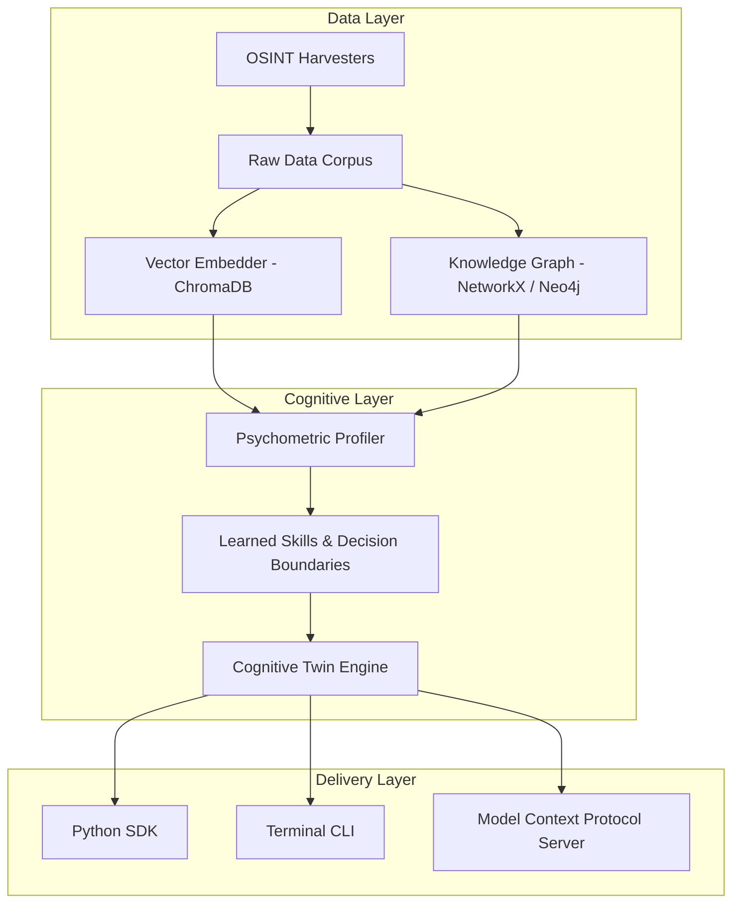

# Architecture & System Design

The `who??` engine operates across three major operational pipelines: **Harvesting & Ingestion**, **Cognitive Modeling**, and **Agent Interface Delivery**.

## 1. Zero-Substitution Entity Resolution
In strict OSINT intelligence, false attribution destroys model validity. The ingestion pipeline enforces exact token matching and disallows hallucinated aliases or name conflation.

## 2. 5-Dimension Behavioral Psychometrics
Profiles are analyzed along five calibrated dimensions:
1. **Machiavellianism & Power Orientation:** Pragmatic utility vs. moralistic emotional framing.
2. **Need for Cognitive Closure (NFC):** Tolerance for ambiguity vs. demand for structured decisiveness.
3. **Prospect Risk Calibration:** Loss aversion ratio ($L/G$) and asymmetric risk preference.
4. **Affective Volatility:** Composure under adversarial challenge vs. emotional escalation.
5. **Moral Foundations Matrix:** In-group loyalty, authority, fairness, and care priorities.

## 3. Active Behavioral Boundaries
Derived rules (e.g. `[TACTICAL_TRANSACTIONALISM]`, `[STOIC_EQUANIMITY]`) actively shape LLM system prompts and prevent persona drift during multi-turn exchanges.
