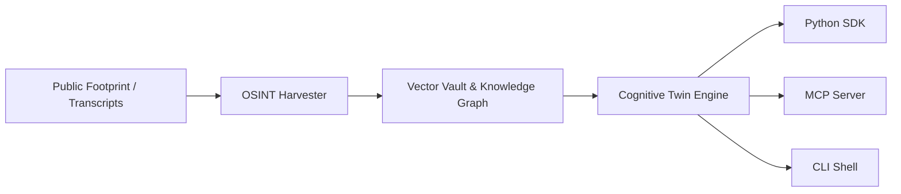

# who?? — Cognitive Digital Twin & OSINT Framework

**who??** is an open-source framework for building probabilistic cognitive digital twins, behavioral psychometric models, and autonomous OSINT research pipelines.

Designed for AI agent orchestration, executive simulations, and academic literature meta-analysis, `who??` models how target entities make decisions, negotiate, and respond to strategic dilemmas.

---

## Key Capabilities

- **Strict Zero-Substitution & Epistemic Honesty:** Grounded in primary quotes and graph nodes. Rejects deterministic psychological speculation.
- **Python Agent SDK:** Idiomatic `from who import CognitiveTwin, AcademicResearcher, list_targets` library for agentic workflows.
- **Model Context Protocol (MCP) Server:** Native JSON-RPC 2.0 stdio server providing 7 tools for Claude Desktop, Cursor, LangChain, and AutoGen.
- **5-Dimension Behavioral Psychometrics:** Quantifies Machiavellianism, Need for Closure, Prospect Risk Calibration, Affective Volatility, and Moral Foundations.
- **Autonomous Academic Referee:** Searches arXiv, PubMed, Semantic Scholar, and OpenAlex to evaluate behavioral hypotheses against peer-reviewed empirical evidence.

---

## Quick Example

```python
from who import CognitiveTwin

# Connect to target's cognitive twin
twin = CognitiveTwin("Target X", mode="formal")

# Execute calibrated in-character query
reply = twin.chat("What is your equilibrium strategy when negotiating with an asymmetric counterpart?")
print(reply)
```

---

## Architecture at a Glance


